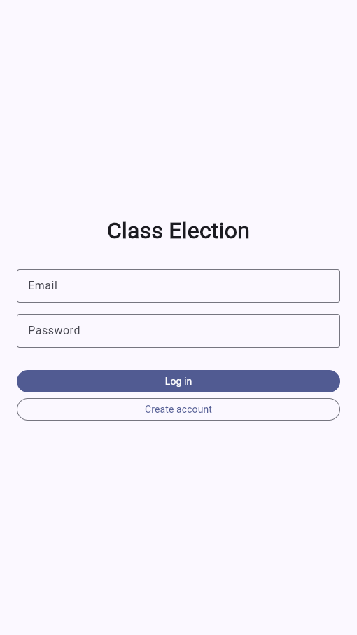
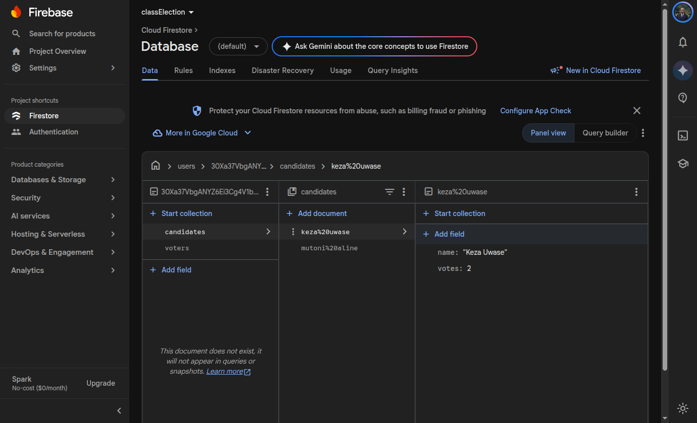
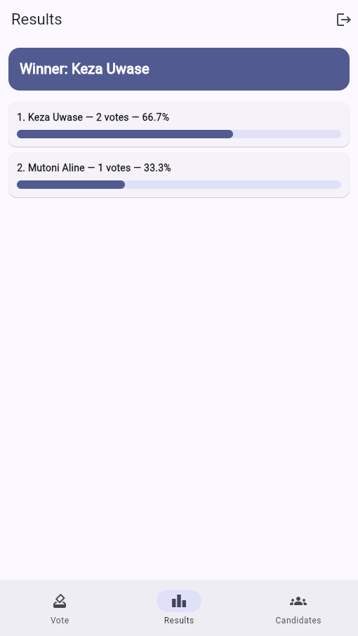
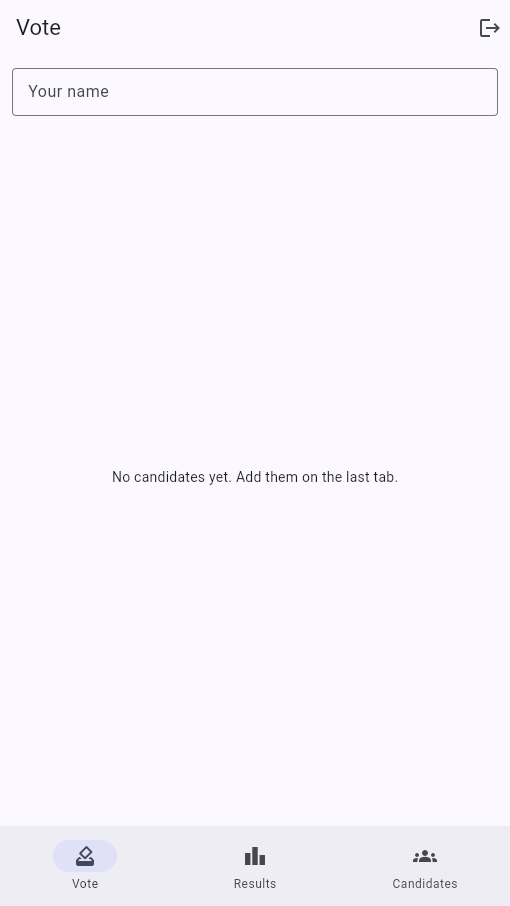

# Class Election

A Flutter voting app for a class election, with Firebase sign-in and live Firestore data.

It signs users in with Firebase Authentication, and each user's data is saved in Cloud Firestore under their own id, so two accounts never see each other's data, and every change appears live.

## Screenshots






## What it does

- Create an account or log in with email and password.
- Add candidates, cast one vote per name, and see results, percentages, ties and the winner.
- Rename a candidate, remove one who has no votes yet, undo a removal, and reset all votes.
- Keep every user's data separate under `users/{uid}/candidates` and `users/{uid}/voters`.
- Update all screens live from Firestore, without refreshing.

## Firestore rules

These rules require sign-in and let each user read and write only their own data. The same rules are in [`firestore.rules`](firestore.rules).

```rules
rules_version = '2';
service cloud.firestore {
  match /databases/{database}/documents {
    match /users/{userId}/{document=**} {
      allow read, write: if request.auth != null
        && request.auth.uid == userId;
    }
  }
}
```

## Run it

1. Run `flutter pub get`.
2. Use the included `android/app/google-services.json` for the Firebase project.
3. In the Firebase console, enable Authentication → Email/Password and create a Firestore database.
4. Publish the rules above in Firestore → Rules.
5. Run `flutter run` on an Android emulator or phone, or `flutter run -d chrome` for the web version.
